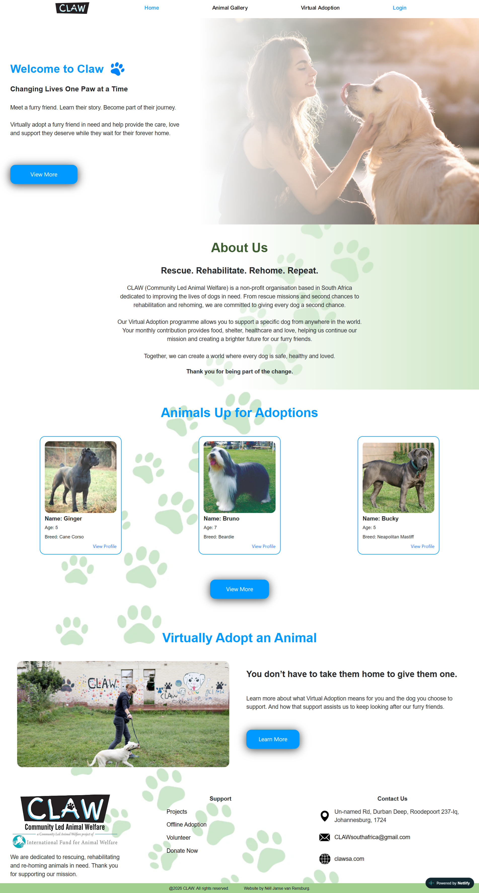
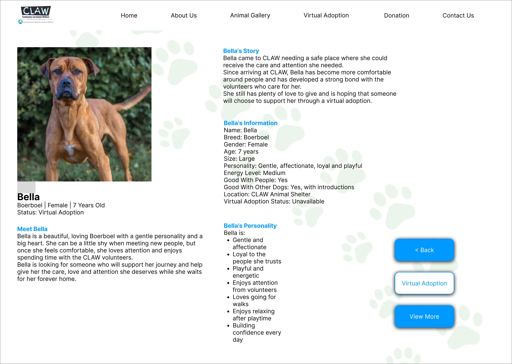

# <p align="center">CLAW Virtual Adoption Application</p>

## This repository was used to deploy using AWS Amplify and EC2, linked [here](https://main.d27iq5vkliqz0x.amplifyapp.com).

### Original Deployed Application [link](https://claw-virtual-adoption.co.za/).

### Original Repository [link](https://github.com/Nell-JvR-251061/claw-virtual-adoption-web).

## Table of Contents

- [Overview](#overview)
- [Design Evolution](#design-evolution)
  - [Homepage](#homepage)
  - [Animal Gallery](#animal-gallery)
  - [Animal Profile](#animal-profile)
  - [Admin Dashboard](#admin-dashboard)
- [Features](#features)
- [Development Tools](#development-tools)
- [Local Setup](#local-setup)
- [Deployment](#deployment)
  - [Railway and Netlify](#railway-and-netlify)
  - [AWS - Amplify and EC2](#aws-amplify-and-E2)
- [Challenges and Solutions](#challenges-and-solutions)
- [Presentation and Demonstration](#presentation-and-demonstration)

## Overview

A web-based application platform for virtually adopting pets and making donations to support CLAW (Community Led Animal Welfare). <br>
DISCLAIMER: This is a partnered-based project between The Open Window Institute and selected NGOs, in which students were tasked to create digital solutions for said NGOs. This is a student-built project for educational purposes, some information and/or features might be inaccurate, missing or incomplete.

## Design Evolution

The original design of the application was created by our UX(User Experience) peers, based on their interviews with a variety NGOs, to help them with their digital problems. Upon receiving these designs, some changes were be made to improve the overall quality and functionality of the application.

### Homepage

<p align="center">Original</p>


<p align="center">Updated</p>



### Animal Gallery

<p align="center">Original</p>


<p align="center">Updated</p>


### Animal Profile

<p align="center">Original</p>



<p align="center">Updated</p>


### Admin Dashboard

<p align="center">Original</p>


<p align="center">Updated</p>


Most of the original design is still in-tact; the only true changes were some content was either cut or changes here and there to keep the project in scope. Additionally there was improvement on spacing and overall flow. I chose to forgo the donation features as I saw no point in implementing a fake feature, however looking back I believe it would have been better to incorporate it.

## Features

- **Homepage:** Introduces the application and provides an entry point to the adoption process.
- **Animal gallery:** Lets users browse animals available for virtual adoption.
- **Animal profiles:** Provides individual pages with information about the selected animals.
- **User registration and login:** Supports account creation and sign-in.
- **Adoption functionality:** Allows users to virtually adopt an animal.
- **Administrative dashboard:** Provides an interface for administrative tasks:
    - Creating/deleting animals.
    - Viewing stats.
    - Deleting users.
- **JWT Token generation and session keys:** Adds security and prevents user's from taking unauthorised actions.
- **Google Analytic 4 tracking and SEO indexing:** Helps gather useful insights on how to improve the application's user experience as well as reach as many people as possible.

## Development Tools
### Frontend
[](https://www.javascript.com/)
[](https://react.dev/)
[](https://www.w3schools.com/css/)
[](https://react-bootstrap.netlify.app/)
<br>Also Bootstrap React Components

### Backend
[](https://expressjs.com/)
[](https://nodejs.org/)
[](https://mongoosejs.com/)
[](https://www.jwt.io/)

### Database
[](https://www.mongodb.com/products/platform/atlas-database)

### Deployment
Frontend:&emsp;[](https://www.netlify.com/)&emsp;**/**&emsp;AWS Amplify<br><br>
Backend:&emsp;[](https://railway.com/)&emsp;**/**&emsp;[](https://aws.amazon.com/ec2/)


## Local Setup
### Prerequisites

- [Node.js](https://nodejs.org/) and npm
- A MongoDB connection string (local instance or [MongoDB Atlas](https://www.mongodb.com/atlas))
- A code editor (VS Code, Notepad++, etBrains IDEs etc.)
- Git

### How to Install

1. **Clone the Repository**

```bash
git clone https://github.com/Nell-JvR-251061/claw-virtual-adoption-web
cd claw-virtual-adoption-web
```

2. **Set Up the Backend**

```bash
cd backend
npm install
```

Create a `.env` file inside `backend/` with:

```
MONGO_URI=your_mongodb_connection_string
JWT_SECRET_KEY=your_jwt_secret
PORT = 5000
```
**!!!!! Do not commit credentials, tokens, or secret environment files to GitHub. !!!!!**

Then start the server:

```bash
node server.js
```

The API will run on `http://localhost:5000`.

3. **Set Up the Frontend**

Open a new terminal:

```bash
cd frontend/LavendarRoute
npm install
npm run dev
```

4. **Run the Project**

Visit the app at the local URL printed by Vite (typically `http://localhost:5173`).

---

## Deployment

### Railway and Netlify
The first deployment separates the React frontend from the Node.js and Express backend.

The deployment arrangement is:

Host the frontend on Netlify.
Host the backend on Railway.
Configure the frontend to send API requests to the deployed backend.
Set the appropriate production environment variables.
Configure CORS to allow requests from the intended frontend origins.
Verify the backend's connection to MongoDB.
Test authentication, animal browsing, adoption functionality, and administrative access on the deployed application.
Live application: https://claw-virtual-adoption.co.za/

When setting up these platforms I needed to ensure they were starting from the correct root folders. For example Railway need to start from the backend folder and not my regular root folder to function properly.

### AWS - Amplify and EC2
The second deployment uses AWS Amplify for the frontend and Amazon EC2 for the backend.

The deployment arrangement is:

Deploy the frontend through AWS Amplify.
Run the backend on an Amazon EC2 instance.
Configure the frontend to communicate with the deployed backend API.
Configure the necessary environment variables and backend settings.
Ensure the backend accepts requests from the appropriate frontend origins.
Verify the MongoDB connection and test the application's functionality.
Live application: https://main.d27iq5vkliqz0x.amplifyapp.com/

My main challenge with AWS was the EC2 section, as the Amplify was auto updating from my repo commits. I needed to do two things to ensure everything was connected. Firstly i needed to install all needed dependencies and Git on the EC2 VM(Virtual Machine), to be able to update the backend properly. Secondly was my Security groups, where I had to make port 5000 and port 22 have 0.0.0.0/0 as their sources; this insures all the cable are attached.

## Challenges and solutions
### Backend Security and Authorisation
One of the major challenges was securing the backend and ensuring that only authorised requests could access protected functionality.

Solution: Authentication middleware was implemented using JSON Web Tokens (JWT). The middleware checks requests for valid authentication tokens before allowing access to protected routes.

This helps separate public functionality from endpoints that require authentication.

### Communication Between Deployment Platforms
Connecting the frontend and backend across different hosting platforms introduced challenges involving cross-origin requests and communication between the deployed services.

Solution: A CORS configuration was implemented with an explicit list of permitted origins. This allows the backend to accept browser requests from approved frontend origins while restricting requests from origins that are not on the allowlist.

The frontend also needs to use the appropriate deployed backend API URL for each environment.

## Presentation and Demonstration
[CLAW Virtual Adoption](https://drive.google.com/file/d/13st2sGQOCWxK2y9AWqxHBQoYyCPzflLu/view?usp=sharing)
